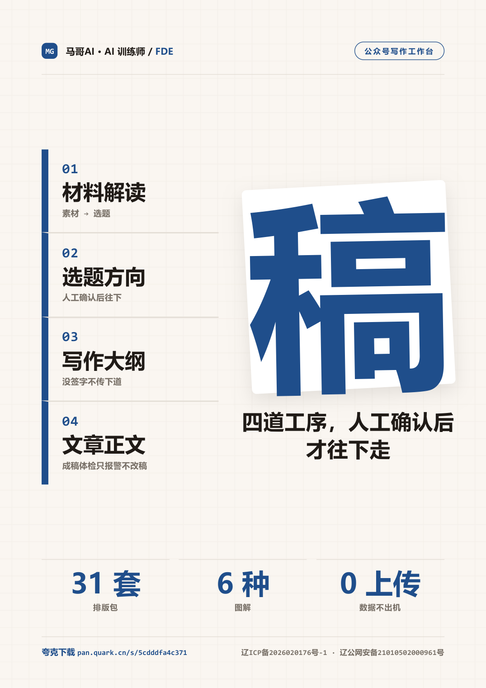

# 稿台（Gaotai）

面向微信公众号创作者的**本地**写作工作台。把素材交给 AI，它分四道工序一步步把它变成能发出去的稿子；
你可以在每一道工序上追问、可以手改；手改的差异被记下来，反过来塑造下一篇的语气。

桌面客户端（Windows / macOS）。数据、模型 Key、公众号凭据都在你自己的机器上：
没有账号、不按字收费。软件**免费使用，但需要注册码激活**（一码一机）。

<!-- brochure:start -->
## 产品宣传彩页

<a href="docs/brochure/gaotai-brochure-v0.6.3.pdf"></a>

**稿台** · 公众号写作工作台：四道工序 · 31 套排版包 · 六种图解 · 零上传

A4 竖版 6 页（封面 / 核心能力 / 能力细节 ×2 / 工作流与部署 / 封底），全部使用真实界面截图。

📄 [下载完整 PDF（v0.6.3）](docs/brochure/gaotai-brochure-v0.6.3.pdf)　·　🖼 [封面大图](docs/brochure/gaotai-brochure-cover.png)

<!-- brochure:end -->

---

## 许可与激活

- **免费使用，需要注册码。** 稿台按 [AGPL-3.0-only](LICENSE) 发布，可免费使用、修改和分发；
  产品仍通过注册码激活后使用。注册码通过服务号或授权服务器领码页发放。
- **首次启动引导激活。** 第一次打开会进入激活页，输入 `GT-XXXX-XXXX-XXXX-XXXX` 格式的注册码。
  激活后客户端持有 30 天有效令牌，剩余不足 7 天自动联网续期（`docs/license-protocol.md`）。
- **未激活时锁住的功能。** 需要联网或调用模型的功能不可用：材料解读、选题、大纲、正文生成、
  获取新增或更新的技能包 / 提示词 / 专题 / 排版包。本地受限模式只保留本地编辑与排版。
- **本地稿件始终归你。** 你创作的稿件、素材、配置只存在本机数据目录，不经过授权服务器。
- **断网仍可用。** 已缓存的技能包、提示词、排版模板和已有稿件在断网时仍可编辑、排版；
  激活 / 令牌续期、获取新资产、调用模型、推公众号草稿才需要联网。

---

## 四道工序

| 工序 | 产出 | 闸门 |
| --- | --- | --- |
| 材料解读 | 硬事实 / 作者的判断 / 待核实之处 / 信息缺口 / 可切的角度 | 你签字 → 进入选题 |
| 选题与方向 | 3 个可选角度（主张、读者、时机、反对意见、风险） | 你选定 → 进入大纲 |
| 写作大纲 | 全文主张 + 推进线 + 说话位置 + 分段（推进、目的、素材、形式） | 你签字 → 进入正文 |
| 文章正文 | 完整 Markdown | 定稿 → 走公众号闭环 |

**没签字的产出不会被当成定稿往下传。** 这是产品里最重要的一条规则：草稿阶段的结论如果被下一阶段当成
既定事实，后面全歪。

几条贯穿全局的分寸（机制细节见 [`docs/使用手册.md`](docs/使用手册.md)）：

- **篇幅默认 700–1200 字**，但字数目标只管到选题和大纲两道工序；正文阶段不给字数指令。
- **正文阶段不给模型任何工具**：写作方法由服务端注入，模型不需要自查一圈。
- **中间产物是施工图，不是稿子**：大纲 700 字、选题 700 字、材料解读 800 字，各有上限。
- **正文只拿骨架**：大纲的结构化部分 + 材料解读的硬事实，不灌前序全文。
- **质量靠报告，不靠机器改稿**：成稿体检只报警、不退回、不改写、不补字。

## 快速开始

```bash
npm install                 # 装依赖（better-sqlite3 / canvas 为预编译二进制）
cp .env.example .env        # 环境变量模板（桌面版不需要；开发态需要登录口令）
npm run dev                 # 开发态，http://127.0.0.1:3060
npm test                    # 单元测试，不需要模型、不联网
npm run typecheck           # tsc --noEmit
npm run build               # Next 生产构建（standalone）
npm run desktop:dev         # 开发态跑桌面壳
npm run desktop:build       # 出安装包与免安装版 → release/
```

开发态要一个登录口令。`.env.example` 里已经给了开发用的 `APP_PASSWORD`，正式用请换成随机值：

```bash
node -e "console.log(require('crypto').randomBytes(32).toString('hex'))"
```

### 桌面版

**第一次打开不用输任何东西。** 客户端每次启动生成一个只存在于本进程的启动令牌，自动换会话；
首启口令会留在 `initial-password.txt` 作兜底（Electron 读走即删）；浏览器直连时可以从
菜单「工具 → 显示本机口令」取回。

`desktop:build` 是一条链，每一步都是一道闸门：
`next build → ensure-runtime-deps → copy-standalone-assets → sanitize-standalone →
prepare-resources → electron-builder`。产物在 `release/`：

- `Gaotai-Setup-<version>.exe` —— NSIS 安装包，可自选安装目录
- `Gaotai <version>.exe` —— 免安装版

没有 Visual Studio 的机器怎么装依赖、Electron 镜像怎么配，见
[`docs/使用手册.md` §14](docs/使用手册.md#14-出包与本地环境)。

## 数据与安全

| 场景 | 要不要口令 |
| --- | --- |
| 桌面客户端（正常入口） | 不要。启动令牌自动换会话 |
| 浏览器直接访问 `127.0.0.1` | 要。本机口令在用户数据目录的 `.env` 里 |

- **数据全在本机**：程序与数据库在 `%APPDATA%\gaotai`，不经过任何服务器；断网时已缓存的技能包、
  提示词、排版模板与已有稿件仍可用（激活与调模型那一下要联网）。
- **自带模型 Key**：不内置模型、不代理、不按字收费；Key 用 AES-256-GCM 加密后落盘，界面只显示掩码。
- **免费但需激活**：软件免费，但首次启动要用注册码激活（一码一机）；激活令牌 30 天有效、
  剩余不足 7 天自动续期，续期失败不阻塞启动（见 [`docs/license-protocol.md`](docs/license-protocol.md)）。
- **口令是机器内部凭证**：后端只监听 `127.0.0.1`，但任何本地网页都够得着这个端口，
  所以浏览器直连仍需口令（挡 CSRF / DNS rebinding）；桌面端用启动令牌替掉「让用户输口令」这个动作。
- **安装包未签名**：Windows SmartScreen 会提示「未知发布者」，点「更多信息 → 仍要运行」即可；
  推广文案里要提前说。
- **推公众号草稿要过 IP 白名单**：微信只认最多 20 个精确公网 IPv4，家宽动态 IP 填了也会失效；
  不想折腾就用「复制排版正文」，零门槛。

## 文档导航

| 文件 | 内容 |
| --- | --- |
| [`docs/spec.md`](docs/spec.md) | 产品与接口规格（**权威口径**） |
| [`docs/使用手册.md`](docs/使用手册.md) | 操作与机制细节：篇幅、技能包、模型接入、公众号闭环、提示词、出包、安全实现 |
| [`docs/产品介绍.md`](docs/产品介绍.md) | 纯文字产品介绍（可直接发布） |
| [`docs/file-map.md`](docs/file-map.md) | 文件归属 + 接手指南 + 10 条坑 |
| [`docs/functional-map.md`](docs/functional-map.md) | 重建对象的功能地图 |
| [`docs/architecture-review.md`](docs/architecture-review.md) | 架构判断：技能包能撑起多少、要不要调格局 |
| [`docs/design/template-gallery.md`](docs/design/template-gallery.md) | 模板画廊 + 手机预览 + WeDraft 接入的设计规则（ADR-0004 事实来源） |
| [`docs/部署与交接方案.md`](docs/部署与交接方案.md) | 全路径 + 建库/出包/分发方案（**含本机路径，勿公开**） |
| [`docs/architecture/decisions/`](docs/architecture/decisions/) | ADR：0001 四道工序 / 0002 正文阶段无工具 / 0003 私域分发 / 0004 模板库与 WeDraft 接入 |
| [`docs/dev-reports/2026-10-26.md`](docs/dev-reports/2026-10-26.md) | 首推前的工程审计、护栏补齐与第二批完成事项 |
| [`CONTRIBUTING.md`](CONTRIBUTING.md) | 提交纪律 + 改动红线 |
| [`AGENT.md`](AGENT.md) | AI 协作的仓库卫生与推送规则 |
| [`SECURITY.md`](SECURITY.md) | 漏洞报告渠道与安全边界 |
| [`CHANGELOG.md`](CHANGELOG.md) | 版本变化 |

## License

本项目主体采用 [AGPL-3.0-only](./LICENSE) 协议。注册码激活不限制 AGPL-3.0 赋予的使用、
修改和分发权利；通过网络提供修改版本时，应履行 AGPL-3.0 第 13 条的源码提供义务。

组件许可边界：
- [Wechatsync](https://github.com/wechatsync/Wechatsync) 衍生多平台同步组件保持
  **GPL-3.0-only（GPLv3）**，不因主项目迁移至 AGPL-3.0-only 而被重新许可；
  GPLv3 原文见 [`THIRD_PARTY_LICENSES/GPL-3.0.txt`](THIRD_PARTY_LICENSES/GPL-3.0.txt)。
- [rico-md](https://github.com/ricocc/rico-md)（MIT）与 [WeDraft](https://github.com/pafa/WeDraft)
  （MIT）的衍生排版模板保留上游版权与 MIT 许可。

分发安装包时请同时提供本声明文件（[`SOURCE.txt`](SOURCE.txt)）、`NOTICE.txt` 与
`THIRD_PARTY_LICENSES/`。

### 第三方组件清单

- **Wechatsync 衍生同步组件**：GPL-3.0-only（GPLv3），许可边界与原文归档见
  `THIRD_PARTY_LICENSES/GPL-3.0.txt` 与 [`NOTICE.txt`](NOTICE.txt)。
- **随包技能包 `human-writing`**：原样引入自
  [KKKKhazix/human-writing](https://github.com/KKKKhazix/human-writing)（v1.1.0，commit
  `4fda173f3fef7fb808f3eba991eeb2528ea4b189`），MIT。许可证原文、版本与溯源随包保留在
  `resources/skills/human-writing/`（`LICENSE` / `VERSION` / `SOURCE.json`）。
- **21 套随包排版样式包**：从 [ricocc/rico-md](https://github.com/ricocc/rico-md) 的 MIT 部分
  **翻译**而来的衍生作品（去 `!important`、去字体栈双引号、色值提取为变量、h2/h3/h4 拆成部件）。
  MIT 要求的版权与许可声明随包保留在 `resources/layout-packs/`
  （`LICENSE-rico-md` 原文 + `SOURCE.json` 逐条溯源）。
  rico-md 另有 12 套 **AGPL-3.0-or-later** 主题（`gzh-design-skill`），本次迁移后
  **那 12 套仍整套没有引入**。
- **7 套随包排版样式包（WeDraft）**：从 [pafa/WeDraft](https://github.com/pafa/WeDraft)（MIT，
  Copyright (c) 2026 pafa and WeDraft contributors）的 7 套模板翻译而来——`reading-editions.ts`
  的 5 套（素笺 / 墨刊 / 青岚 / 蓝图 / 朱砂）+ `default-business.json`（小哈公社）+
  `next-edition.json`（小哈公社 New）。上游是「元素 → CSS 声明」，稿台是「部件 → HTML 模板」，
  按 ADR-0004 的映射表转换，装饰能力（`headingNumber` / `quoteMark` / `imageCaption` / `reference*`）
  第一版不引入，作为已知限制记录。MIT 版权与许可声明随包保留在 `resources/layout-packs/`
  （`LICENSE-wedraft` + `SOURCE-wedraft.json`）。
- **`gaotai-longform`**：本仓库自研，按 AGPL-3.0-only 或该技能包保留的 MIT 许可双许可提供；
  既有 MIT 授权继续有效，不因主项目许可迁移而撤销。来路见
  `resources/skills/gaotai-longform/NOTICE`。
- **`gaotai-editorial`**：本仓库自研，按 AGPL-3.0-only 发布。
- 其余第三方依赖以 npm 依赖引入，各自许可文本保留在安装后的 `node_modules` 内，不随仓库分发。

汇总见 [`NOTICE.txt`](NOTICE.txt)。若后续要公开分发或商用，建议先请熟悉开源合规的人过一遍
上述文件与 `docs/` 下的规格与交接文档。
